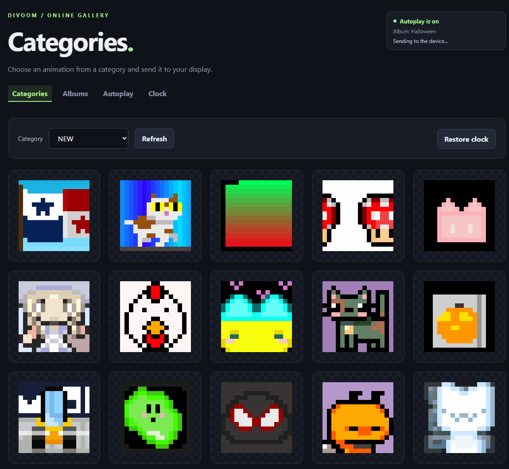

# Divoom Ditto Pro Online Catalog Client

A web application for browsing the Divoom community gallery and displaying
16x16 pixel art on a Divoom Ditto Pro. Explore categories and albums, send artwork
to your display, or let automatic rotation alternate animations with your clock.



## Features

- Browse gallery categories and Discover albums with animated previews.
- Send still images and animations to your display from the browser.
- Rotate artwork automatically from a chosen category or album, with configurable
  intervals and display duration.
- Restore the clock between automatic animations and customize its style and color.
- Keep autoplay preferences, clock appearance, playback history, and downloaded
  artwork across restarts.
- Access a password-protected interface served by a single Go executable with
  embedded web assets.

Automatic rotation runs in the background while the application is running,
including when no browser is connected. Manual artwork and clock commands pause
rotation; resume it through the web interface when ready.

## Requirements

- Go 1.23 or later to build or run from source.
- A Divoom community account for gallery access.
- A running [Divoom device HTTP gateway](https://github.com/lAnubisl/divoom-ditto-pro-client)
  connected to your display, with its URL and API key.

The application fetches artwork from Divoom's hosted gallery and controls the
display through the separate gateway. Run one controller per account and device.

## Getting started

Set the following environment variables in your shell. These PowerShell examples
use placeholders; replace them with your own values:

```powershell
$env:DIVOOM_API_BASE_URL = 'http://YOUR-SERVER:8080'
$env:DIVOOM_API_KEY = 'YOUR-API-KEY'
$env:DIVOOM_GALLERY_EMAIL = 'your@email.example'
$env:DIVOOM_GALLERY_PASSWORD = 'your-gallery-password'
$env:DIVOOM_WEB_PASSWORD = 'your-private-web-password'

go run ./cmd/server
```

Open [http://127.0.0.1:8090/](http://127.0.0.1:8090/) and sign in with
`DIVOOM_WEB_PASSWORD`. The device URL should exclude the `/api` suffix.
[.env.example](.env.example) lists the available settings; the application reads
process environment variables and does not load `.env` files automatically.

On first startup, autoplay starts with the **NEW** category, a five-minute
interval, and a ten-second display duration. Use the web interface to choose a
category or album, adjust timing, or pause playback. Saved preferences take
priority on subsequent starts.

### Optional configuration

| Variable | Default | Purpose |
| --- | --- | --- |
| `DIVOOM_WEB_HOST` | `127.0.0.1` | Address the web server listens on |
| `DIVOOM_WEB_PORT` | `8090` | Web server port |
| `DATA_DIR` | `var/lib/divoom_gallery_web/` | Directory for settings, history, and cached artwork |

The default data directory is relative to the working directory. Downloaded
artwork is cached without automatic eviction. For access from another machine,
set `DIVOOM_WEB_HOST=0.0.0.0` and use the server's address. Use a trusted LAN or an
HTTPS reverse proxy for remote access.

## Build

```sh
go vet ./...
go build -o bin/divoom-gallery-web ./cmd/server
```

On Windows, use `bin/divoom-gallery-web.exe` as the output filename. For Linux
service installation and updates, see the [deployment guide](deploy/README.md).

## Documentation

- [Device gateway integration](docs/http-client-agent-guide.md)
- [Clock controls](docs/clock-settings.md)
- [Divoom hosted API reference](docs/divoom-api/README.md)
- [Artwork formats and decoding](docs/divoom-api/divoom-artwork-formats.md)
- [Linux service deployment](deploy/README.md)

## Acknowledgements

Gallery protocol and artwork decoding references include
[APIxoo](https://github.com/redphx/apixoo). The web interface uses
[HTMX](https://htmx.org/). See [third-party notices](THIRD_PARTY_NOTICES.md) for
attribution and license details.
