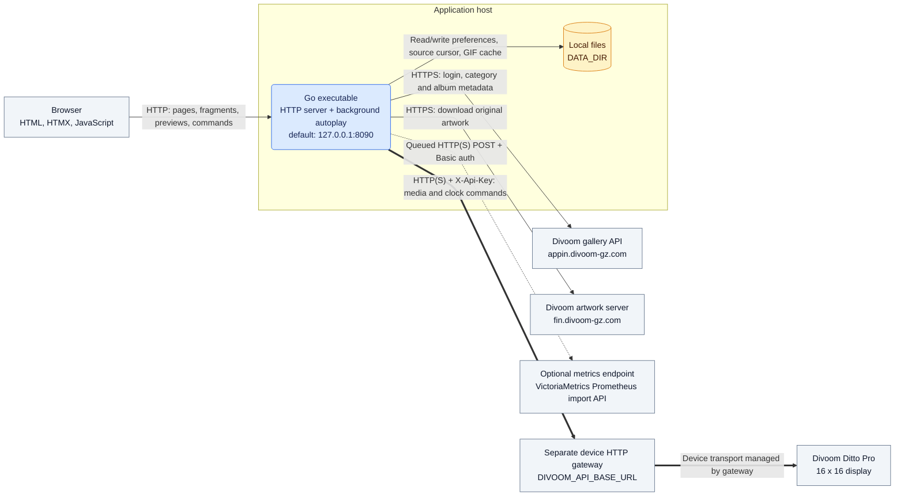
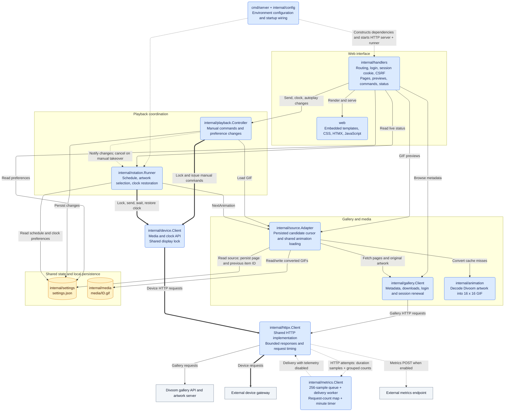

# Architecture

This document describes the current implementation in this repository. The
application is a single Go executable containing an HTTP server, embedded web
assets, and a background autoplay scheduler. It stores state in local files and
controls the display through a separately deployed HTTP gateway.

The diagrams use Mermaid and render directly in GitHub Markdown or a Markdown
viewer with Mermaid support. The component diagrams use the following styles:

| Element | Style |
| --- | --- |
| Internal components | Blue rounded rectangles |
| Browser, external services, and device | Gray rectangles |
| Local file storage | Amber cylinders |
| Calls and data access | Solid arrows `-->` |
| Device commands | Thick arrows `==>` |
| Notifications, telemetry, and startup wiring | Dotted arrows `-.->` |
| Connector routing | Straight segments with gently rounded turns (`curve: rounded`) |

Responses are implicit in the component diagrams. The sequence diagram uses
matching blue participants and amber notes, with solid request arrows and dashed
response arrows.

## System overview



Gallery credentials and the device API key stay on the application server. The
browser communicates with this application, which fetches gallery data and
forwards media or clock commands. The gateway owns the physical device
connection; its transport implementation is outside this repository.

## Components inside the Go process



These are logical components within one process, not separate services. Gallery,
device, and metrics clients use separate configured instances of the shared HTTP
helper. Metrics delivery disables its own telemetry to prevent recursion.
Playback and rotation consume interfaces backed by the same source adapter and
device client, so previews and sends reuse the same media cache, and manual and
automatic device operations share one lock. The source adapter owns candidate
selection and stores its page and previous item ID in settings. The runner
requests the next candidate without maintaining a separate playback record.

## Main runtime flows

### Browse and preview

1. A signed-in browser requests category or album metadata through the handlers
   and gallery client. Listing metadata does not download artwork for decoding.
2. A preview request calls the source adapter. A valid cached GIF is returned
   immediately.
3. On a cache miss, the gallery client downloads the original artwork, the decoder
   converts it to GIF, and the media store saves it. The handler returns the GIF.
   A download or decoding failure returns an error without caching the response.

### Automatic playback

```mermaid
%%{init: {"theme": "base", "themeVariables": {"actorBkg": "#dbeafe", "actorBorder": "#2563eb", "actorTextColor": "#172554", "noteBkgColor": "#fef3c7", "noteBorderColor": "#d97706", "noteTextColor": "#451a03"}}}%%
sequenceDiagram
    participant R as Rotation runner
    participant A as Source adapter
    participant S as Settings store
    participant D as Device client / gateway

    Note over R,D: Runner reads saved timing and source; no browser is required
    R->>D: Acquire shared display lock
    R->>A: NextAnimation
    A->>S: Read source, page and previous item ID
    A->>A: Find next eligible item; wrap at remote end
    A->>S: Persist advanced cursor
    A->>A: Load cached GIF or download and decode
    A-->>R: GIF bytes
    R->>D: POST /api/images or /api/animations
    D-->>R: Send completed
    R->>R: Wait configured display duration
    R->>D: POST /api/display/clock
    D-->>R: Clock command completed
    R->>D: Release shared display lock
    Note over R: Wait until next scheduled cycle
```

The sequence shows a successful cycle. Each iteration calls `NextAnimation`
once. The source adapter resumes after the saved item on the saved page,
filters metadata, persists the selected item's cursor, and loads its animation.
It starts from page 1 when it reaches the remote end. A complete scan without
selectable items reports an empty source.

Download, decode, and upload failures end the iteration. The scheduler waits
until the next scheduled cycle, which requests the next animation using the
already advanced cursor. Failed items remain eligible after the cursor wraps.
A clock restoration failure stops autoplay and exposes an error in the UI.

### Manual commands

A send or clock command passes through the playback controller's command gate.
The controller persists the autoplay pause and notifies the runner to cancel
automatic work, including pending clock restoration during manual takeover. It
then acquires the shared display lock and sends the command. Autoplay remains
paused until resumed. A successful gateway response confirms send completion;
it does not verify the physical display's rendered output.

## Persistence and deployment

| Location | Owner | Contents |
| --- | --- | --- |
| `DATA_DIR/settings.json` | `internal/settings` | Autoplay source, page and previous item ID, timing, enabled state, clock appearance |
| `DATA_DIR/media/<ID>.gif` | `internal/media`, populated by source adapter | Converted GIFs retained without automatic eviction |

The default data directory is `var/lib/divoom_gallery_web/`, relative to the
working directory. The supplied systemd service uses
`/var/lib/divoom-gallery-web` and starts the executable from
`/opt/divoom-gallery-web`. It reads environment configuration from
`/etc/divoom-gallery-web/divoom-gallery-web.env` and restarts on failure.
Templates and static assets are embedded at build time; no separate frontend
server, database, or message broker is required. Run one controller per account,
device, and media directory.

Metrics are enabled only when `DIVOOM_METRICS_URL` is set.
Gallery/device HTTP attempts enqueue samples for one background worker. Its queue
holds 256 pending samples; full queues drop new samples, and delivery failures
are logged without failing the originating operation. Shutdown allows up to five
seconds to flush the queue and final partial request-count window. HTTP duration
samples send immediately. The metrics client also counts HTTP attempts
in a map keyed by service, method, and path. Every minute it swaps the map and
sends one batch containing `divoom_http_requests_per_minute` samples for all active
groups; new attempts accumulate in the next window. Counts include failed attempts
and duration samples dropped by a full queue. Empty windows send no count samples;
failed count deliveries are logged without retries.

## Implementation references

- [Startup and dependency wiring](../cmd/server/main.go)
- [HTTP server and scheduler lifecycle](../cmd/server/web.go)
- [Routes and web security](../internal/handlers/server.go)
- [Manual command coordination](../internal/playback/controller.go)
- [Automatic playback and selection](../internal/rotation/runner.go)
- [Gallery/media adapter](../internal/source/adapter.go) and [gallery API client](../internal/gallery/client.go)
- [Device gateway client](../internal/device/client.go) and [integration contract](http-client-agent-guide.md)
- [Shared HTTP helper](../internal/httpx/http.go) and [metrics worker](../internal/metrics/client.go)
- [systemd service](../deploy/divoom-gallery-web.service)
